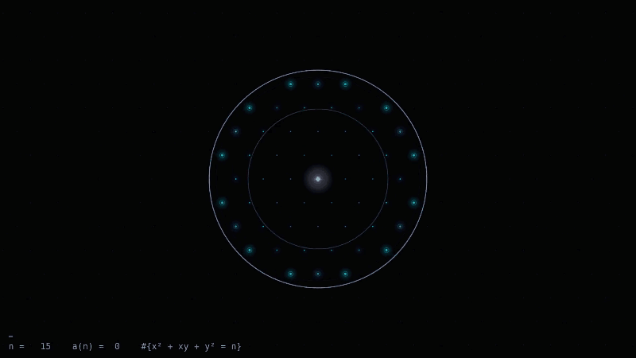
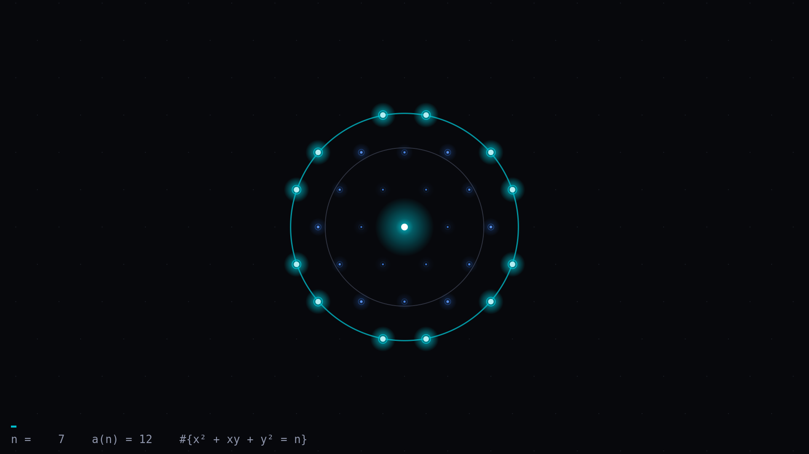
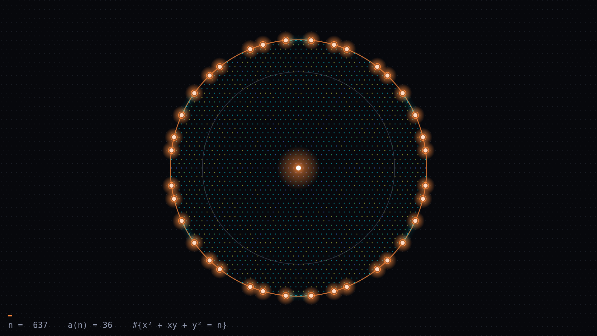
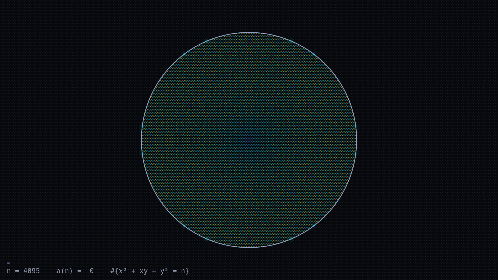

# The Sound of the Hexagonal Lattice

An audiovisual take on [OEIS A004016](https://oeis.org/A004016), the theta series of the
planar hexagonal lattice. Term *a(n)* is the number of lattice points at squared distance
*n* from the center. The video moves outward one shell per note and lights up the points
on each shell as its note plays.

[](https://github.com/kp-automata/sound-of-the-hexagonal-lattice/releases/download/v1.0/preview-shells-0-200.mp4)

*The first 25 seconds, with sound: [preview-shells-0-200.mp4](https://github.com/kp-automata/sound-of-the-hexagonal-lattice/releases/download/v1.0/preview-shells-0-200.mp4)*

> Most integer sequences out in the wild sound very bad. They typically are increasing, so
> it's just a melody with higher and higher notes. When I was exploring sequences this one
> was an outlier aesthetically.
>
> I was also not expecting the beautiful tapestry-like pattern to emerge, so that was a
> pleasant surprise. :)

## The math

$$a(n) = \left|\lbrace (x, y) \in \mathbb{Z}^2 : x^2 + xy + y^2 = n \rbrace\right|$$

The lattice point $(x, y)$ sits at $(x + y/2,\ y\sqrt{3}/2)$ in the plane, so its squared
distance from the origin is exactly $x^2 + xy + y^2$. Shell *n* is the circle of radius
$\sqrt{n}$, and *a(n)* counts the lattice points on it:

```
n    :  0  1  2  3  4  5  6  7  8  9
a(n) :  1  6  0  6  6  0  0 12  0  6

n    : 10 11 12 13 14 15 16 17 18 19
a(n) :  0  0  6 12  0  0  6  0  0 12
```



Every nonzero term after a(0) is a multiple of 6, because the lattice is unchanged by a
60° rotation. Most shells are empty, and the nonzero values come from a small set
(6, 12, 18, 24, 30, 36, 48). That's why the sequence sounds like a melody instead of a
steady climb. The first 4096 terms cover 14,839 points spread over 1,003 non-empty shells.

## How it was made

1. **Sound.** OEIS will turn any sequence into a MIDI file (the "listen" link). Here every
   term is one note with pitch `a(n) + 20`, so an empty shell plays the lowest note. The
   MIDI ([`output/A004016.mid`](output/A004016.mid)) went into a DAW with a synth bass
   at 8 notes/s, giving a 512 s render.
2. **Sync.** The rendered wav is the source of truth for timing. [`audio.py`](audio.py)
   finds note onsets using spectral flux and checks that they sit on a uniform 0.125 s grid
   (measured drift over the whole file: 0.00 ms). At 48 fps that's exactly 6 frames per note.
3. **Picture.** [`scene.py`](scene.py) draws each frame with pycairo as a pure
   function of the frame index. It draws the dim base lattice, the shells already passed
   (colored by their *a(n)*), a wavefront ring at radius √n, and a glowing flash on the
   current shell. The camera zooms out as the ring grows.
4. **Video.** Raw frames go straight into GStreamer (x264 + AAC), with no PNG sequence on
   disk. [`verify.py`](verify.py) decodes the finished mp4 and confirms the audio
   lag is constant from start to end.



As the passed shells pile up, the disk fills in with the pattern below:



## Running it

Python dependencies (`numpy`, `pycairo`) are managed with [uv](https://docs.astral.sh/uv/).
Encoding uses GStreamer 1.x with the `x264enc`, `avenc_aac` (gst-libav) and `mp4mux`
plugins; ffmpeg isn't needed. On Linux, pycairo builds from source, so it needs the cairo
headers:

```sh
# Debian/Ubuntu
sudo apt install libcairo2-dev pkg-config gstreamer1.0-tools \
    gstreamer1.0-plugins-good gstreamer1.0-plugins-ugly gstreamer1.0-libav
uv sync
```

The audio (130 MB) is attached to the [latest release](https://github.com/kp-automata/sound-of-the-hexagonal-lattice/releases/latest)
rather than kept in the repo:

```sh
curl -L -o output/lattice.wav \
  https://github.com/kp-automata/sound-of-the-hexagonal-lattice/releases/latest/download/lattice.wav
```

To use your own sound instead, render `output/A004016.mid` through any synth at 120 BPM
(one sixteenth note per term, 0.125 s) and save it as a **24-bit, 44.1 kHz wav** at
`output/lattice.wav`. Then, from the repo root:

```sh
uv run python -m data                     # compute the shells, check them against OEIS -> out/shells.npz
uv run python -m audio                    # measure the beat grid in the wav -> out/timing.json
uv run python -m encode                   # 10 s sync smoke test -> out/smoke.mp4

uv run python -m render still 7 637 4095  # PNG stills at given n -> out/stills/
uv run python -m render clip 0 200 --scale 0.5   # quick preview with audio
uv run python -m render full              # 1920x1080 @ 48 fps -> out/A004016.mp4
uv run python -m verify                   # check frame count and A/V sync of the full render
```

Every look parameter (palette, glow, camera, HUD) is in [`style.py`](style.py).
`uv run python -m render compare 0 240` renders the variants in `style.VARIANTS` side by side.
